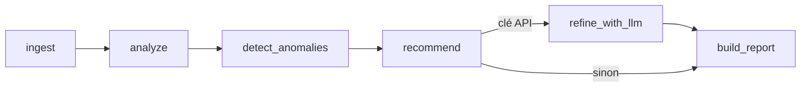

# Optimisation de l'infrastructure technique

Pipeline qui analyse les logs de supervision d'une PME, détecte les anomalies et
propose des actions d'optimisation à Jean, le CTO. Énoncé : [docs/enonce.md](docs/enonce.md).

- **Entrée** : [data/rapport.json](data/rapport.json), 500 relevés toutes les 30 min.
- **Sortie** : [output.json](output.json), au format demandé.

## Lancer le projet

```bash
python -m venv .venv
.venv\Scripts\activate          # Linux/macOS : source .venv/bin/activate
pip install -r requirements.txt

python -m infra_optimizer        # lit data/rapport.json, écrit output.json
python -m pytest                 # 10 tests
```

Options : `--input`, `--output`, et `--no-llm` pour n'utiliser que les règles.
Le LLM (Claude) n'est appelé que si `ANTHROPIC_API_KEY` est définie, par exemple
dans un fichier `.env` (voir `.env.example`).

## Architecture

Le pipeline est un graphe LangGraph de 6 étapes qui se partagent un même état :
chaque étape lit ce dont elle a besoin et y ajoute ses résultats.



| Étape | Rôle |
|---|---|
| `ingest` | Lit le JSON, écarte les relevés invalides (ex. CPU à 150 %), trie par date |
| `analyze` | Calcule les indicateurs (latence moyenne, CPU max…) et la disponibilité de chaque service |
| `detect_anomalies` | Compare chaque métrique à ses seuils et chaque service à son objectif de disponibilité |
| `recommend` | Choisit dans le catalogue les recommandations déclenchées par les anomalies |
| `refine_with_llm` | *(optionnel)* Claude priorise et reformule les recommandations |
| `build_report` | Assemble le rapport final |

| Fichier | Contenu |
|---|---|
| [config.py](infra_optimizer/config.py) | Tous les réglages : seuils par métrique, objectif de disponibilité, modèle LLM |
| [playbook.py](infra_optimizer/playbook.py) | Le catalogue des recommandations |
| [models.py](infra_optimizer/models.py) | Format d'un relevé, format du rapport, état du graphe |
| [nodes.py](infra_optimizer/nodes.py) | Les étapes `ingest` → `build_report` (sauf le LLM) |
| [llm.py](infra_optimizer/llm.py) | L'étape LLM |
| [graph.py](infra_optimizer/graph.py) | L'enchaînement des étapes |
| [\_\_main\_\_.py](infra_optimizer/__main__.py) | La ligne de commande |

## Choix techniques

- **Python** : c'est le langage de référence pour la donnée et l'IA. Pour 500 relevés,
  le module standard `statistics` suffit, sans pandas.
- **LangGraph** : il rend les étapes et leur enchaînement explicites, y compris le
  passage optionnel par le LLM. Ajouter une étape se fait en une ligne.
- **Pydantic** : il valide les relevés en entrée, garantit le format du rapport en
  sortie et impose un format de réponse au LLM.
- **Les calculs sont faits par du code, pas par le LLM.** Les chiffres d'un rapport
  doivent être exacts et reproductibles. Le LLM se contente de reformuler et de
  prioriser.
- **Les recommandations sont des données, pas du code.** Le catalogue est une simple
  liste de dictionnaires, facile à relire et à compléter.
- **Le LLM est encadré.**
  - Sa réponse suit un format imposé, vérifié automatiquement.
  - Il ne peut pas modifier les paramètres techniques.
  - En cas d'erreur (réseau, clé, quota, réponse invalide), le rapport est quand
    même produit avec les recommandations du catalogue.
  - Le SDK officiel d'Anthropic est utilisé directement, avec le modèle
    `claude-opus-5-5` par défaut (réglable dans `config.py` ou via `.env`).

## Méthode de détection

- **Métriques.** Chaque métrique a trois seuils dans `config.py` : `low`, `medium`
  et `high`. Dès que `low` est dépassé, c'est une anomalie, et sa sévérité est le
  niveau le plus élevé atteint par le pic. On produit une seule anomalie par
  métrique, plutôt qu'une par relevé.
- **Services.** La disponibilité d'un service est la part des relevés où il est
  `online`. En dessous de 99 %, c'est une anomalie : sévérité `high` si le service
  a été hors ligne, `medium` s'il a seulement été dégradé. On indique aussi le taux
  d'erreur pendant ses incidents, pour mesurer leur impact réel.
- **Récurrence.** Si au moins la moitié des intervalles entre deux incidents ont la
  même durée, la description l'indique (« Récurrent : toutes les 5 h »).

## Choix d'interprétation du format de sortie

- `timestamp` : date de génération du rapport.
- `insights.error_rate` : taux d'erreur moyen. `insights.uptime_seconds` : uptime au dernier relevé.
- `anomalies` :
  - `value` est le pic observé et `threshold` le seuil du niveau de sévérité retenu.
  - Pour un service, `metric` vaut `<service>_availability_pct`, `value` est sa
    disponibilité et `threshold` l'objectif de 99 %.
- `service_status_summary` : chaque service est classé selon son **pire** statut sur
  la période. Au dernier relevé, tout est `online` : se fier uniquement à ce relevé
  masquerait les incidents.

## Ce que révèlent les données

1. **Des pics de charge toutes les 5 h.** CPU jusqu'à 99 %, latence de 384 ms contre
   132 ms habituellement, taux d'erreur de 13 %, et l'API gateway se dégrade.
2. **La base de données est hors ligne toutes les 3h30**, alors que le taux d'erreur
   reste normal (0.020 contre 0.032 en moyenne globale). Il s'agit probablement
   d'une sonde de santé trop sensible ou d'une tâche planifiée, plutôt que d'une
   vraie panne.
3. **Le cache se dégrade toutes les 15 h**, au même rythme que les pics de threads.
4. **Un relevé toutes les 30 min, c'est trop peu** pour mesurer la durée réelle des coupures.

## Modifier le projet

- **Changer un seuil** : modifier la ligne de la métrique dans `config.py`.
- **Ajouter une recommandation** : ajouter un dictionnaire dans `playbook.py`. Ses
  textes peuvent citer des mesures, comme `{cpu_usage_max}` ou `{cache_availability_pct}`.
- **Surveiller une nouvelle métrique** : ajouter le champ dans `LogRecord`
  (`models.py`) et une ligne dans `THRESHOLDS` (`config.py`).
- **Ajouter une étape** : écrire une fonction `def mon_etape(state) -> dict` dans
  `nodes.py`, puis la brancher dans `graph.py`.

## Limites

- Les seuils sont des valeurs courantes, à ajuster avec l'équipe selon ses objectifs.
- Les gains annoncés sont des estimations.
- Les données décrivent un seul serveur. Pour un parc, il faudrait un champ `host`
  et une analyse par machine.
